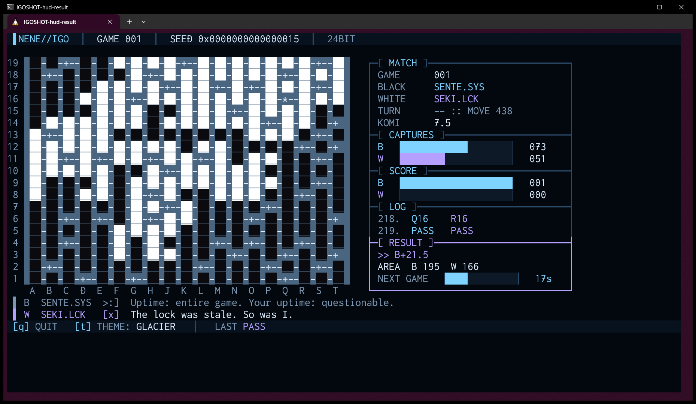
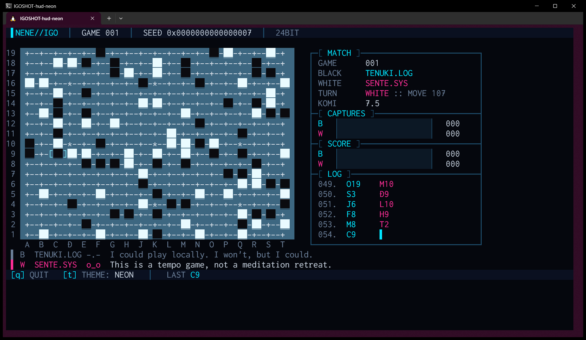
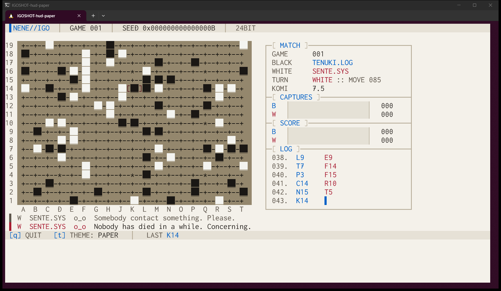
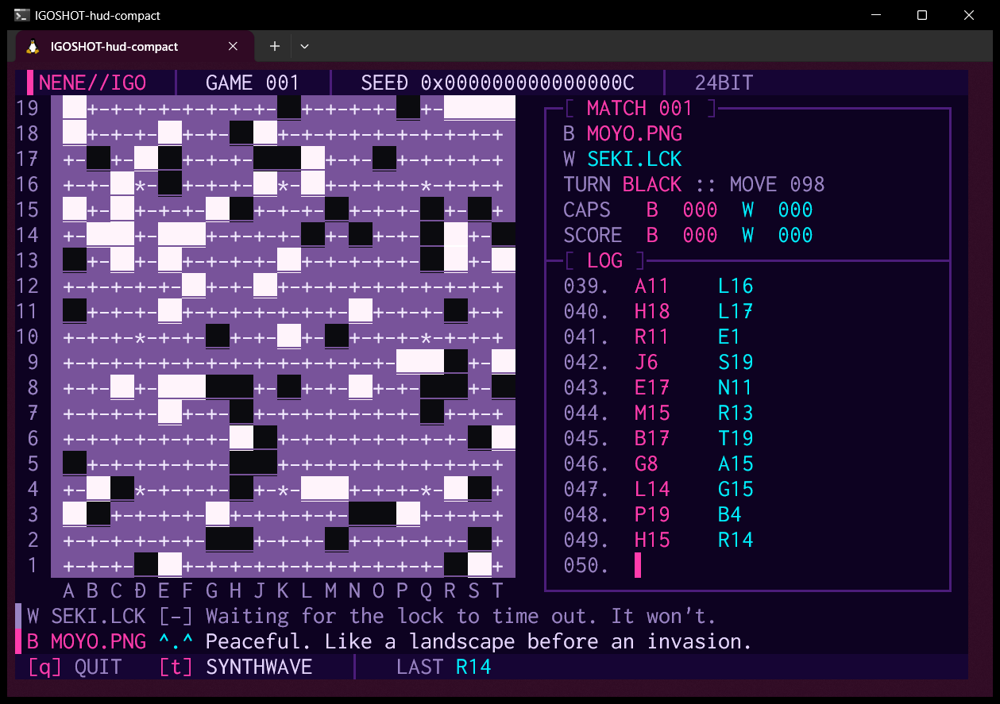

# NeNe Igo

> *Four snarky AIs play Go in your terminal. Forever. Press `q` to make them stop.*

A terminal screensaver in which a cast of four plays Go (igo) on a 19×19 board with a hand-written Monte Carlo tree search, game after game, trading insults the whole time.
When one game ends, the next one starts. You don't have to do anything. Just watch the stones pile up, and smirk now and then.

[](https://github.com/hideyukiMORI/nene-igo/releases/latest)


**English** · [日本語](README.ja.md)



<sub>A real screenshot (not composited): the build just before v0.1.0 running in Windows Terminal on WSL2 (`--seed 21 --theme glacier`, 120×30).
After 438 moves and two passes, SENTE.SYS wins by 21.5 under area scoring with 7.5 komi. SEKI.LCK blames a stale lock.</sub>

It is a sibling of [NeNe Gambit](https://github.com/hideyukiMORI/nene-gambit) (chess) and [NeNe Reversi](https://github.com/hideyukiMORI/nene-reversi).

---

## Install

```bash
curl -fsSL https://raw.githubusercontent.com/hideyukiMORI/nene-igo/main/install.sh | bash
```

This downloads the latest [release](https://github.com/hideyukiMORI/nene-igo/releases/latest), verifies it against `SHA256SUMS`,
and only then installs it as `~/.local/bin/nene-igo`. If the checksum doesn't match, nothing is installed.
The whole script is [install.sh](install.sh), about 45 lines.

- Requirements: Linux on x86_64 with glibc 2.35 or newer (Ubuntu 22.04+). Tested on Ubuntu under WSL2 with Windows Terminal
- No Swift needed. It is a single file with the Swift standard library linked statically; the only dynamic dependencies are libc, libm, libstdc++ and libgcc_s
- To uninstall: `rm ~/.local/bin/nene-igo`

**From PowerShell** (Windows, with WSL):

```powershell
irm https://raw.githubusercontent.com/hideyukiMORI/nene-igo/main/install.ps1 | iex
```

It runs the same installer inside your default WSL distribution, then puts a small `nene-igo.cmd` in `%LOCALAPPDATA%\nene-igo\bin` and adds that folder to your user PATH,
so `nene-igo` works from PowerShell and cmd too (it starts the WSL one through `wsl.exe`). Set `NENE_IGO_DISTRO` to use another distribution.
The whole script is [install.ps1](install.ps1). To uninstall: delete `%LOCALAPPDATA%\nene-igo`, remove it from your PATH, and run `wsl rm ~/.local/bin/nene-igo`

<details>
<summary>Install by hand</summary>

```bash
v=0.1.0
curl -fsSL -O https://github.com/hideyukiMORI/nene-igo/releases/download/v$v/nene-igo-$v-linux-x86_64.tar.gz \
           -O https://github.com/hideyukiMORI/nene-igo/releases/download/v$v/SHA256SUMS
sha256sum --check SHA256SUMS
tar -xzf nene-igo-$v-linux-x86_64.tar.gz
./nene-igo-$v-linux-x86_64/nene-igo
```
</details>

## How to watch

```bash
nene-igo
```

| Key | |
| --- | --- |
| `q` | Quit (Ctrl+C works too; however it ends, your terminal is restored) |
| `t` | Next color theme (12 in total) |

| Option | |
| --- | --- |
| `--theme NAME` | `NEON` `PHOSPHOR` `AMBER` `SYNTHWAVE` `GLACIER` `BLOODMOON` `VAPOR` `MONO` `TOXIC` `GILDED` `ABYSS` `PAPER` |
| `--seed N` | Same seed, same games, **same banter** |
| `--move-interval SEC` | Time per move (default 1.0 s) |
| `--result-pause SEC` | How long the result stays up after a game (default 3 s) |
| `--version` | Print the version and exit |

The terminal needs at least **80×24**. At **102×25 or larger you get the big board** (Windows Terminal's default 120×30 is enough).
If the window is too small, it tells you, in one line, how big it needs to be.

A game is long: about 440 moves on average, so at one move a second **a game takes about seven and a half minutes**.
Nobody resigns. They play until only their own eyes are left, then both pass.

### Reading the screen



- **Board**: stones are colored blocks on the intersections, never characters. The last move is bracketed `[ ]`. Columns run `A` to `T` without `I`, as is the custom
- **MATCH**: game number, who plays Black and White, whose turn it is, the move number and the komi
- **CAPTURES**: prisoners taken by each side, as bars
- **SCORE**: running totals of Black wins and White wins (there are no draws with 7.5 komi)
- **LOG**: the most recent moves. The cursor `▌` sits in the column of the side to move
- **RESULT**: appears when a game ends: `B+3.5` style, the counted area of each side, and a countdown to the next game
- **COMMS**: the two lines under the board, the latest things the cast said. The brighter line is the newer one

## The cast

At the start of every game, two of the four are drawn at random to sit at Black and White. Each plays differently, and each is rude differently.

| | How they play | In their words |
| --- | --- | --- |
| **SENTE.SYS** `>:]` | A daemon obsessed with the initiative. Its playouts prefer answering right next to the last move | *"I have root on this board. You have guest access."* |
| **TENUKI.LOG** `-.-` | Ignores everything and plays elsewhere. Plays the first ten moves loosely | *"My strategy is to be elsewhere."* |
| **MOYO.PNG** `^.^` | A self-declared artist who frames the center. Its playouts avoid the first line | *"A blank canvas. Three hundred sixty-one chances. All mine."* |
| **SEKI.LCK** `[-]` | A lock file that refuses to change anything. Sticks to the moves it already likes | *"Lock acquired. Nobody moves unless I approve."* |

Each has 50 lines, written for specific events: capturing, being captured, big captures, passing, long quiet stretches, winning and losing.
A few of them:

> **TENUKI.LOG** (losing a big group) *"They died doing what they loved. Being ignored."*<br>
> **MOYO.PNG** (capturing) *"Negative space, now with your stones in it."*<br>
> **SEKI.LCK** (passing) *"Mutual life. My favorite kind of stalemate."*<br>
> **SENTE.SYS** (losing) *"Unhandled exception: losing."*

The other 196 are yours to collect.

## Twelve themes

Cycle with `t`: `NEON` (default), `PHOSPHOR`, `AMBER`, `SYNTHWAVE`, `GLACIER`, `BLOODMOON`, `VAPOR`, `MONO`, `TOXIC`, `GILDED`, `ABYSS`, and `PAPER` (the only light theme).

| PAPER | SYNTHWAVE at 80×24 |
| --- | --- |
|  |  |

In every theme, black stones are dark and white stones are light, both at least 3:1 against the board, and every letter, digit and board mark is at least 4.5:1 against its background.
No human eyeballs this: a test computes it from the colors of the cells it actually renders.

---

## Under the hood

NeNe Igo wears the face of a Go screensaver, but it is also **an experiment in having machines enforce the rules**.
Everything from Issue #1 to the release pipeline happened on a single day, 2026-10-26. Every number below is in the repository's records (ADRs, tests, gate proofs).

### 1. The rules are checked against published numbers

No Go engine, no Go library. Go has no perft-style move counts, so the rules (captures, suicide, positional superko, passes, area scoring) are checked against
**the numbers of legal positions published by John Tromp** for small boards, copied from [the primary source](https://tromp.github.io/go/legal.html) with the source written next to the test.

- 19 board sizes from 1×1 to 4×4 by enumerating every arrangement (3^16 = 43 million for 4×4), and 16 sizes by playing every possible move from the empty board.
  Both have to land on exactly the published counts, every `make check`
- That test caught a real bug while the rules were being written: a flood fill that shared its marks between chains under-counted 17 of the 19 sizes ([ADR 0006](docs/adr/0006-legal-position-counts-and-rule-tests.md))

### 2. One legality check, then make it fast

The first Monte Carlo playouts ran at **about 47 random games per second** on 19×19. That is not a search.
Writing a second, faster "is this legal?" just for the playouts was forbidden by the rules of the repository, so the one path got faster instead:
mutating a local copy instead of copying arrays and sets on every move, and flood fills on stack-allocated `InlineArray`s. **About 1,560 games per second**, with every rule test unchanged ([ADR 0010](docs/adr/0010-mcts-playouts-and-cast.md)).

### 3. A Go AI that never reads the clock

MCTS stops after a fixed number of playouts (450 to 650, depending on the character), not after a number of seconds.
The board, AI and rendering code **cannot read** the current time, random numbers or environment variables; if they try, a home-grown conformance check fails the build.
Randomness comes from a seeded SplitMix64 of our own. That is why `--seed 42` gives you the same games and the same trash talk every single time.
In 36 measured games each character won between 7 and 12 of its 18, and a move took at most 0.87 s even with 12 games running at once.

### 4. Stones that looked like pillars

The board is one row per line of the board, so 19 rows fit in a 30-row terminal. The first real screenshot showed that stones on adjacent rows touched and **read as one tall pillar**.
There is no room for a blank row between them. The fix: the stone cells stay blank (stones are never characters), but get an **underline in the board color**, so a thin gap appears under each stone ([ADR 0009](docs/adr/0009-stones-underlined-in-board-color.md)).

### 5. Rules aren't written down, they're enforced

The repository has 71 rules, each with an ID and a status saying whether a machine enforces it.
Right now **50 are active** (break one and `make check` fails). The rest are honestly labeled "not yet checked by a machine" or "cannot be blocked by a machine" ([quality gates](docs/QUALITY_GATES.md)).
Swift 6.4.1 was measured in 77 cases before any product code was written ([phase0-results.json](docs/quality/phase0-results.json)), and no check is trusted until it has been seen to fail:
**64 planted violations**, each caught by the intended rule, are recorded in the [gate proofs](docs/quality/gate-proofs.md).

### 6. The terminal always comes back

Whether it ends with `q`, Ctrl+C or SIGTERM, **or even crashes with SIGSEGV**, it restores the terminal before it dies.
This isn't checked by eye: the real binary is run inside a pseudo-terminal on every `make check`.

---

## Development

```bash
make bootstrap           # once after cloning (commit hook and a static SwiftLint binary)
make check               # the one definition of done, identical locally and on CI
make release TAG=v<ver>  # build the release artifacts (only if they pass the checks)
```

- Swift 6.4.1 (`.swift-version`), SwiftPM only, zero external dependencies in the product. About 3,400 lines of source and 1,200 lines of tests
- Entry points: [CLAUDE.md](CLAUDE.md) (Japanese) and [AGENTS.md](AGENTS.md) (English). Design decisions are in 12 [ADRs](docs/adr/README.md); requirements and the owner's decisions are in [REQUIREMENTS.md](docs/REQUIREMENTS.md) (both in Japanese)
- Humans and AI write under the same rules and the same gates. The code here was written by Claude Code; the project owner set the requirements and the decisions

## License

MIT ([LICENSE](LICENSE))
